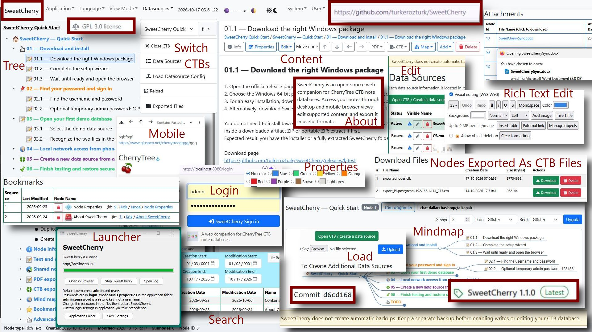

# SweetCherry

SweetCherry is an open-source web companion for [CherryTree](https://www.giuspen.net/cherrytree/) CTB note databases.

Browse your notes in desktop and mobile web views, explore them as mind maps, edit supported content, and export nodes or branches to PDF and CTB. SweetCherry complements CherryTree; it does not replace it.

## Download and start

[Download the latest stable release](https://github.com/turkerozturk/SweetCherry/releases/latest). The release page contains the Windows x64 installer and portable ZIP with Java 17 included. Windows users do not need to install Java separately. Extract the portable ZIP before running `SweetCherry.exe`.

- [Installation and usage — English](documentation/en/setup-and-run.md)
- [Kurulum ve kullanım — Türkçe](documentation/tr/installation.md)
- [Build from source — Türkçe](documentation/tr/setup-and-run.md)

**SweetCherry does not create automatic backups.** Back up important CTB files yourself. Do not write to the same file simultaneously from SweetCherry and CherryTree. Read-only tenant configuration is available.

## Features and documentation

- Rich-text editing, images and attachments, external links, tables, embedded codebox editing, and formatted web-page paste.
- Node movement by arrows or parent ID with clipboard/bookmark shortcuts, Go to Node ID, duplication, shared-node hierarchy, and reorderable bookmarks.
- Preview and import exported CTBs into a writable database, preserving hierarchy and remapping internal IDs.
- Tenant configuration wizard, SQLite/MariaDB/MySQL/PostgreSQL connections, and application settings editors.
- Markmap, Mermaid, Freeplane/FreeMind export with optional content notes, and PDF export with hierarchical navigation. Offline LaTeX rendering in content and PDF.
- Local use or configurable network access; offline sun and moon calculations.

[CTB export](documentation/tr/ctb-export.md) · [Shared nodes](documentation/tr/shared-node-operations.md) · [Network access](documentation/tr/network-access.md) · [Optional features](documentation/tr/optional-features.md) · [Versioning](documentation/tr/versioning.md)

## Release information

[Changelog](CHANGELOG.md) · [1.3.0 release notes](documentation/releases/v1.3.0.md) · [1.2.0 release notes](documentation/releases/v1.2.0.md) · [1.1.0 release notes](documentation/releases/v1.1.0.md) · [Screenshot capture plan](documentation/images/1.1/README.md)

Development builds are not currently published as a separate download channel. Use the stable release for ordinary use; source builds from `main` may include unreleased changes.

## Development

SweetCherry is developed and maintained by Türker Öztürk. ChatGPT/Codex assistance was used for implementation, test code and documentation; project decisions, review and manual release validation remain with the maintainer.

## License

SweetCherry is licensed under GNU GPL version 3 or later. See [LICENSE](LICENSE). Bundled third-party components retain their own licenses.
